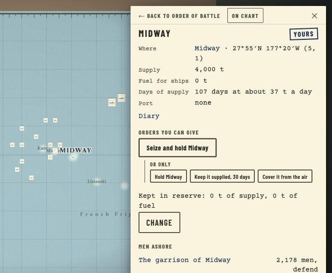
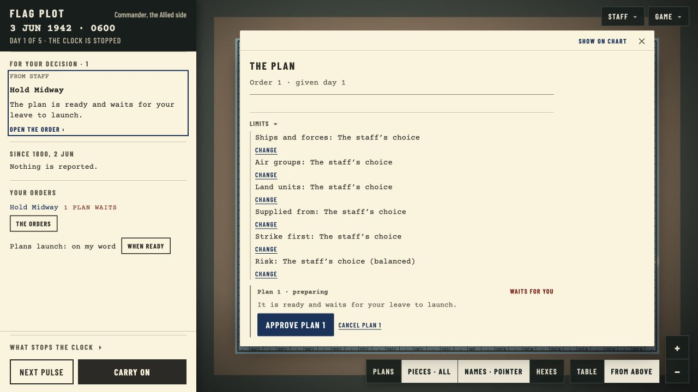

# Flag Plot User Manual

Flag Plot is an operational wargame of the Pacific War. You command the Allied or Japanese side in a historical scenario and tell your staff what you want to achieve. The staff turns your objectives into tasks and orders. You can inspect its reasoning, limit the resources it may use, hold a plan for approval, or give a unit an order yourself.

Your chart shows your own forces and the reports your side has received about the enemy. Ships burn fuel, air groups tire, and bases use up supplies while you decide what to do with those reports. The result of a battle depends on what you can still do tomorrow as well as what you accomplish today.

## Contents

1. [Starting a game](#1-starting-a-game)
2. [The chart table](#2-the-chart-table)
3. [Sequence of play](#3-sequence-of-play)
4. [Orders to the staff](#4-orders-to-the-staff)
5. [Direct orders and control of units](#5-direct-orders-and-control-of-units)
6. [Intelligence and reports](#6-intelligence-and-reports)
7. [Naval operations](#7-naval-operations)
8. [Air operations](#8-air-operations)
9. [Land operations and supply](#9-land-operations-and-supply)
10. [Dry runs](#10-dry-runs)
11. [Objectives and results](#11-objectives-and-results)
12. [First command at Midway](#12-first-command-at-midway)

## 1. Starting a game

Open [Flag Plot](https://flagplot.lazyjack.app) in your browser. On **A New Game**, select a scenario, choose **Allied** or **Japanese**, leave the other side set to **The Engine**, and click **Begin**. The scenario description gives the duration and each side’s mission. Once the table opens, read the opening directive for your side’s orders and guidance.

| Scenario | Length | What you will command |
| --- | --- | --- |
| The Eastern Solomons | 1 day | A carrier battle resolved as a whole day. Review your opening orders before advancing time. |
| The Coral Sea | 5 days | A carrier battle and a landing operation at Port Moresby. |
| Midway | 5 days | Carrier forces, the airfield and garrison at Midway, and submarines. The Allied opening is covered in [First command at Midway](#12-first-command-at-midway). |
| The Eastern Solomons: five days | 5 days | A reinforcement convoy, carrier forces, and the airfield at Lunga. |
| Guadalcanal: the first thirty-nine days | 39 days | An extended campaign in which shipping, supply, and accumulated losses shape what you can do ashore and at sea. |

**Keeping your game.** The hosted game runs in the current browser page. Leave the tab open to keep your position. Reloading starts the scenario again from its first evening. **Game → Restart** starts the same scenario and side over. **Game → New Game** returns to the scenario chooser. Each action asks for a second click.

## 2. The chart table

Drag the chart to move your view. Scroll or pinch to zoom. **From Above** gives you a north-up view, and **Table** returns you to the angled view. Use **Plans** to show plans on the chart, **Pieces** and **Names** to change the display, and **Hexes** to show the grid and coordinates.

Click a piece to open its card. Friendly forces and enemy contacts use different shapes, and dashed contact markers fade as reports age. When several pieces share a position, use the card’s arrows to step between them. Names in orders and reports also open their cards. **On Chart** centers the view on the selected item when the control is available.

| Where to look | What you will find |
| --- | --- |
| **For Your Decision** | Plans waiting for approval, requests from your forces, and unread directives when present. |
| **Why the Clock Stopped** and **Since** | The reason for an interruption and the reports received since the previous stop. |
| **Your Orders** and **Signed** | Orders in force, the launch permission setting, and signed entries awaiting action. Open **The Orders** to see your orders together and review their rank. |
| **Staff → Directives** | The mission and guidance sent by your superior. |
| **Staff → Order of Battle** | Your forces at sea and ashore. Click a name to inspect it. |
| **Staff → Report** or **Situation** | The evening account at 1800, or the current situation when stopped inside a day. |
| **Staff → Intelligence**, **War Diary**, or **Reinforcements** | The enemy picture, a record of reported events, and the arrival schedule when applicable. |

On a narrow screen, click the **Flag Plot** header above the clock to reopen the stop paper if it collapses. **Esc** closes the active card or paper, or brings up the discard prompt for a draft with changes. In an order draft, **Ctrl+Enter** or **Cmd+Enter** signs when **Sign and Send** is available.

## 3. Sequence of play

A game day begins at **1800 on the preceding calendar date**. For a scenario whose first day is 3 June, give the opening orders at 1800 on 2 June. The clock identifies the day those orders are for.

| When | What to expect |
| --- | --- |
| **1800** | Review the report and issue orders for the coming day. When time advances, pending orders and commands for that day go in and the staff is asked for its orders. |
| **1800 to 0600** | The night pulse resolves. Forces can move, handle cargo, and encounter other forces. |
| **0600 to 1200** | The morning pulse resolves. Daylight air operations and further movement can bring in new reports. |
| **1200 to 1800** | The afternoon pulse resolves. At its end the game closes the day and returns to the evening decision point. |

**Next Pulse** plays one pulse in scenarios that let you intervene within the day. At 0600 or 1200, some direct orders can act in the upcoming pulse. Orders to the staff and other orders that require dusk wait for 1800. Read **Acts** before signing and **Signed** afterward to check the timing. If the button reads **Next Day**, the scenario resolves the whole day before you can act again, even if the table plots its events in stages.

**Carry On** advances time until a stop condition fires, the scenario ends, or you click **Stop the Clock**. An active pulse or whole-day step finishes before a manual stop. Open **What Stops the Clock** to select the events you want to hear about, such as a contact, a loss, or a staff request. Tick **each evening** to pause daily where that option is offered. Read **Why the Clock Stopped** before carrying on again.

## 4. Orders to the staff

### 4.1 Giving an objective

An **intent** is the outcome you ask the staff to bring about or maintain. Click the base, force, or waters that the order concerns. Under **Orders You Can Give**, choose an objective. The available orders depend on the place, scenario, and forces at hand. The paper opens headed by that order in words, for example "Keep Thornwick supplied"; to give another order, use the way back at the top of the paper and choose again on the card.

| Objective | What you are asking of the staff |
| --- | --- |
| **Hold** a friendly base | Keep the place in your hands. The staff can form tasks for its defense and support. |
| **Keep it supplied, 30 days** | Try to maintain the stated supply floor. The staff needs a source, available shipping, and time to deliver. |
| **Cover it from the air** | Assign air protection to a place using suitable groups in reach. |
| **Capture** or **Seize and hold** | Take a particular place, or conduct the wider operation for a named island. A wider order can already include tasks for individual places. |
| **Neutralise** an enemy base | Suppress the base’s ability to operate. |
| **Deny these waters** | Task available forces to act against enemy activity in the selected area. |
| **Operate** a carrier force, **Station** a surface force, or **Patrol these waters with submarines** | Ask for a force or boats to work from or within the selected waters, where offered. |

In the order paper, a supply order asks for the ships and the base it is supplied from, under its heading, and cannot be signed until both are named. Open **Limits** to set **Risk**, where offered, and the other controls that apply to this order; **Risk** is its first line. **Balanced** is the default. **Preserve** asks for greater caution and **Press** permits greater risk. How much the staff changes its plan depends on the objective and situation. A patrol shows its boats, and a station order its risk, on the paper itself. The limits may include eligible forces, a supply source, an operating area, or a timing or intelligence requirement. These may include eligible forces, a supply source, an operating area, or a timing or intelligence requirement. An additional limit can leave the staff with too few means to act.

Read **The Staff’s Reading** before you choose **Sign and Send**. It shows how the staff would carry out the draft and can flag a shortage of suitable forces or another obstacle. Open a task’s **Why** to see what informed the choice. Use **Tear Up** to discard the draft. A signed order appears under **Your Orders** when in force, with pending entries shown under **Signed**. Use **Take Back** on a pending entry while it is still available.

### 4.2 Supervising a plan

Click an intent under **Your Orders** to open its plan. Read from the objective down to its tasks and the units assigned. **Why** explains the decision at that task. **Show on Chart** puts the plan in geographic context where available. Use the **Change** control beside an available limit to revise it and read the new preview. Where orders compete for the same resources, review their priority under **The Orders**.

With **Plans launch** set to **On My Word**, a ready plan needing your leave appears under **For Your Decision**. Open the entry and select its numbered **Approve Plan** button. Check when the approval takes effect. **When Ready** gives the staff standing permission to launch eligible plans. An approval gives leave to proceed under the current conditions and limits. As the situation changes, the staff may have to wait or change what it orders.

Use **Cancel Plan** on a plan where offered. Use **Withdraw This Order** when you want to end the underlying objective. Before leaving the paper, check **Signed** for any change that still awaits 1800.

## 5. Direct orders and control of units

Click a friendly task force, air group, land unit, or submarine and choose **Give a Direct Order** when offered. The paper is headed by the unit's name and shows the choices for that unit and who will control it. When the order acts is said beside **Sign and Send**. Review the draft before signing. As the order takes effect, the unit is held in your hands. A held unit is kept out of the staff’s plans.

Use **Return It to the Staff** on a held unit’s card when you want the staff to use it again. Some cards also let you keep a unit out of the staff’s plans without giving it an immediate task. Before taking a unit, check whether it already serves an objective elsewhere. A plan may now have to wait or find another unit.

When an order paper reports **Not Sent**, read the reason beside that line. Check which parts were sent before trying again. If the entry is still pending and you want to reverse it, open **Signed** and use **Take Back**.

## 6. Intelligence and reports

An enemy **contact** is a report about a force. The reported position, number of ships, or largest type seen may be wrong. Its card gives the report’s age and **How We Know**. A new report may refresh a contact, and a contact can go stale or disappear as the evidence changes. Suspected submarine waters describe an area of concern.

A **claim** records what your own crews believe they hit or destroyed. Read it as their account of the action. The staff works from the same information available to your side. Consider the age and source of a sighting before committing forces or changing the plan.

Open **Staff → Intelligence** to look across sightings, lost contacts, claims, enemy bases, and other information your side holds. Use the **Evening Report** to review what happened and what needs attention for the next day. The **War Diary** gives the events in more detail. Follow linked names to see the forces and places involved. [Search, contacts and claims](rules/03-search-contacts-and-claims.md)

## 7. Naval operations

A **task force** moves and acts as a group. Open its card to inspect its course, speed, readiness, remaining range, and ships. The range shown for a force can be limited by a single ship. Check fuel for the outward passage, time on station, and the return. Full speed can get a force there sooner and leave it with less fuel for the next job.

On the direct-order paper, use **Course** to pick waypoints on the chart and set speed or readiness where needed. If another eligible force has an oiler, the paper can offer **Fuel at sea from a force with an oiler**. Choose the supplying force and check the order’s timing. The receiving force cannot sign a course in the same draft as that refuelling order. Base cards can also let you form a force from ships shown as in port and in no force.

Read the ship cards after an engagement. A ship can still be afloat with a damaged flight deck or propulsion out. Damage, fuel, ammunition, and the time required in port all matter when you count the ships available for another operation. Where a scenario has submarines, you can assign eligible boats through a staff patrol order or give a boat a station through its card. Check its condition and remaining salvoes before counting on it. [Movement, fuel and cargo](rules/02-movement-fuel-and-cargo.md) · [Damage and repair](rules/04-surface-combat-and-damage.md) · [Submarines](rules/10-submarines.md)

## 8. Air operations

An air group operates from a base or a carrier. From the base, force, or ship card, follow the group’s name to inspect the aircraft ready to fly, its current mission, and the limits of its reach. Search arcs and strike range can appear on the chart when you inspect the relevant units or plans.

Air groups may search, provide fighter cover, strike, or rest, according to their type and available missions. The direct-order paper shows the missions for that group and lets you set a search arc when applicable. Before giving an order, check readiness, fatigue, range, and the state of the airfield or flight deck. Aircraft assigned to one job may be needed for another. A force within nominal range can still lack an effective strike because of readiness, the strength it can assemble, or the contact it holds. [Air operations](rules/05-air-operations.md)

## 9. Land operations and supply

Open the base card to inspect its stocks, days of supply, air groups, and men ashore. **Days of Supply** estimates how long the stock will last at the use shown on the card. It will change as use and deliveries change. A sizeable stock can fall quickly if more troops arrive or the base’s activity increases.

A landing needs troops, shipping, time to unload, and a way to feed the men once ashore. Read the staff’s plan for what must happen before it can go, which forces are available, and how supply is expected to follow. Convoys take time to load, reach their destination, and unload. Port capacity and the transport available affect what can be delivered.

A land unit’s card shows its strength, posture, fatigue, and whether it was fed. Where offered, give a direct order to change its posture, issue or halt a march along a land link, or choose what it does when free to work or train. Taking a base gives you a new position. Keeping it useful requires supplied troops and working facilities. [Land units](rules/07-land-units.md) · [Staff supply doctrine](rules/08-the-staff/doctrine.md#the-doctrine-keep-a-base-supplied)

## 10. Dry runs

Where offered, **Dry Run** lets you try a draft or an existing plan before committing to a change. Open it from the order or plan paper. The staff plays a set of possible situations based on the information available to your side. The estimate can show how often the aim was met and held, when it was met, and the range of losses or costs. Open the detail for what the staff assumed about the enemy and where the runs differed.

Use a comparison where offered to see what changes between courses. A trial can help you judge whether to change risk or timing. Its figures depend on the information, assumptions, and period covered by those runs. Running a trial leaves the live game and unsigned draft as they were. Sign the change separately if you decide to make it. [Trial rules](rules/09-the-trial.md)

## 11. Objectives and results

Use your directive and the scenario mission to judge what matters before committing forces. Scored objectives vary by scenario. They can count a base held at the end, days an airfield stayed open or shut, troops or cargo landed, or ships and aircraft put out of action. A short battle and a long supply campaign can reward very different decisions.

At the end, **How It Ended** shows the result and what each side achieved. Use **Read How It Ended** to reopen it after closing the paper. Compare the result with your **War Diary** to see what you knew when you acted and what the scenario ultimately counted. [Objectives and results](rules/06-objectives-and-results.md)

## 12. First command at Midway

Start **Midway** as **Allied** against **The Engine**. It is 1800 on 2 June. Your directive calls for holding Midway and defeating the enemy carriers. Give the staff an opening objective, then see what it asks of you at dawn.

1. Close the directive. Select Midway on the chart, or open **Staff → Order of Battle** and click the base under **Ashore**.
2. On Midway’s card, choose **Hold Midway** under **Orders You Can Give**, in the **Or Only** row. Leave risk at **Balanced** (under **Limits**), read **The Staff’s Reading**, and click **Sign and Send**.

   

3. Leave **Plans launch** at **On My Word**. Click **Next Pulse** to stop at 0600 on 3 June. Under **For Your Decision**, open the **Hold Midway** entry and click **Approve Plan 1**. The approval is signed for 1800.

   

4. Close the plan. Use **Next Pulse** to stop at 1200 and then at 1800. Open **Staff → Report** at the evening stop. Read what happened, check what is signed for tonight, and decide what should interrupt you on the next day.

For a shorter walkthrough, see the [QuickStart](quickstart.md). For an introduction to the design, see [The game of command](game-concepts.md). For definitions and mechanics, see the [glossary](glossary.md) and [rulebook](rules/README.md).
