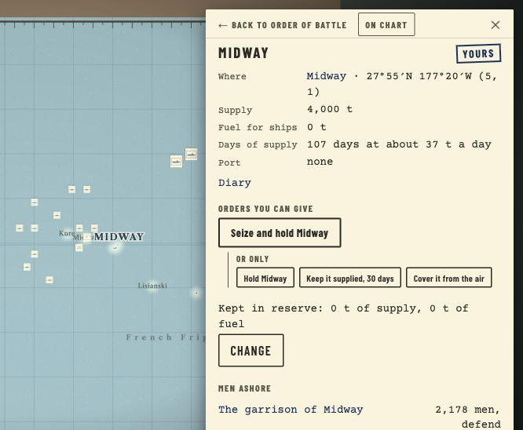
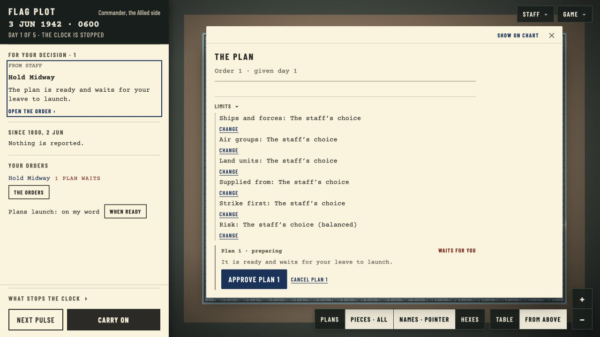

# Flag Plot QuickStart

It’s 1800 on 2 June 1942. Midway is in Allied hands, your carriers are at sea, and the opening directive warns that a Japanese force is on its way. Your mission is to hold the atoll and destroy the enemy carriers while keeping your own in action.

In Flag Plot, you give the staff an objective and it works out which units and orders can serve it. In your first watch, you’ll order the defense of Midway, decide whether to release the staff’s plan at dawn, and see what the day’s reports tell you.

## 1. Open the table

Open [Flag Plot](https://flagplot.lazyjack.app) in your browser to play.

On **A New Game**, select **Midway**, choose the **Allied** seat, leave the other side set to **The engine**, and click **Begin**. The opening directive gives you your mission. You can reopen it under **Staff → Directives**.

## 2. Give the order to hold Midway

1. Close the directive and select **Midway** on the chart. Drag to move around and scroll to zoom. **From Above** gives you a north-up view. You can also open Midway’s card by clicking its name under **Ashore** in **Staff → Order of battle**.
2. On the Midway base card, find **Orders You Can Give** and choose **Hold Midway** in the **Or Only** row. Leave the risk at **Balanced** for this first order.

   

3. Read **The Staff’s Reading** before you sign. Which units can help hold the atoll? Where is the staff short of options? Open a task’s **Why** to see what shaped the decision.
4. Click **Sign and Send**. If the stop paper collapses, click the **Flag Plot** header above the clock to reopen it. **Signed** shows when the order will take effect. Click **Hold Midway** under **Your Orders** to review the plan, then close it to return to the table.

## 3. Make the 0600 decision

1. Click **Next Pulse** to play the night and stop at 0600 on 3 June. The staff has a plan ready and asks for leave to launch.
2. With **Plans launch** set to **On My Word**, **Hold Midway** appears under **For Your Decision**. Click **Open the Order** to read what the staff is ready to do, then click **Approve Plan 1**. The approval appears under **Signed** and takes effect at 1800. **When Ready** under **Your Orders** lets the staff launch eligible plans automatically on future turns.

   

3. Close the plan and click **Next Pulse** twice more, pausing at 1200 and then 1800. **Since** shows the reports from each pulse when there are updates. At 1800, open **Staff → Report** to read the **Evening Report**.

When a sighting comes in, click the contact’s name in the report to open its card. Check **How We Know** and the report’s age. A fresh sighting can still get the count or type of ships wrong, and dashed contact markers fade as reports age. How much would you risk on that report alone?

Once you are comfortable stepping through time, open **What Stops the Clock**, choose which events should interrupt play, and click **Carry On**. Tick **each evening** if you want a daily pause. When an event interrupts play, **Why the Clock Stopped** tells you what happened. While time is running, click **Stop the Clock** to pause. Scenarios with whole-day turns show **Next Day** in place of **Next Pulse**.

## 4. Command the rest of the battle

- **Change the plan.** Open an order under **Your Orders** to inspect its tasks. Use the change control beside **Risk** to adjust it or **Withdraw This Order** to end it. Where offered, **Dry Run** estimates outcomes from the staff’s current picture before you commit.
- **Take direct control.** Open a unit card and choose **Give a Direct Order**. Check **Acts** for when it takes effect. Once the order takes effect, the unit is in your hands and stays out of staff plans. Use **Return It to the Staff** when you want the staff to use it again. To undo a pending entry, use **Take Back** under **Signed**.
- **Finish the scenario.** **How It Ended** opens when the game finishes and shows the result and what each side achieved. After closing it, click **Read How It Ended** to reopen it. Use **Game → Restart** to replay Midway or **Game → New Game** to choose another scenario. Both actions ask for a second click.

For more controls, see [The table](../table/README.md). For game terms, see the [glossary](glossary.md).
